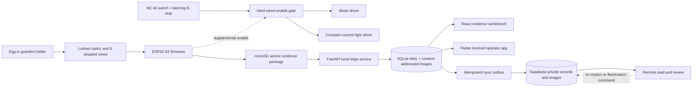

# System architecture

The capstone is one safety-critical local instrument plus two non-safety
clients. Only the box can complete a scan without the network; only a physical
button or an authenticated local client may request one.

## Authority boundaries

| Authority | Can start a physical scan | Can append review | Can change machine result |
|---|---:|---:|---:|
| Box button after interlocks | Yes | No | No |
| Paired local operator | Yes | No | No |
| Local/remote reviewer | No | Yes | No |
| Cloud client | No | Yes, role permitting | No |
| Simulator | No physical action | Synthetic records only | No |

## Persistence sequence

1. Firmware captures into a temporary microSD inspection directory.
2. It verifies every JPEG and the canonical manifest before marking the
   directory upload-ready.
3. The laptop stores images under their SHA-256 content address.
4. One SQLite transaction inserts inspection metadata, eight view rows, the
   immutable machine result, an audit event, and an outbox event.
5. A cloud worker retries immutable event IDs. Partial evidence never changes a
   local inspection into `COMPLETED` and repeated delivery never creates a new
   inspection UUID.

The current repository executes steps 4 and the simulator portion of step 5's
queue contract. Physical microSD ingestion and provisioned cloud delivery still
require hardware and a Supabase project.
